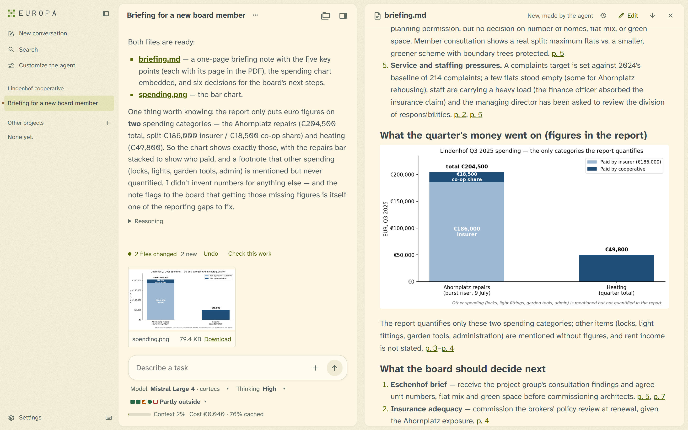
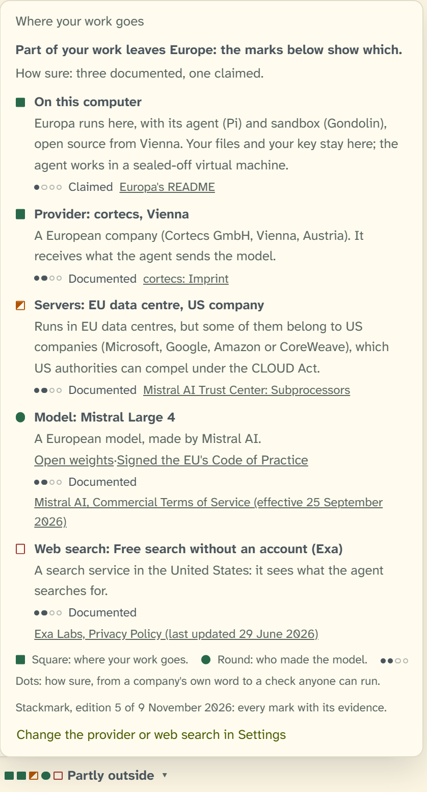
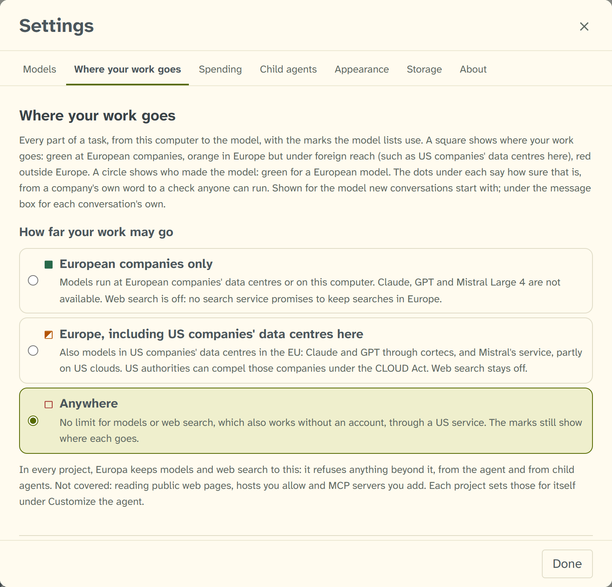
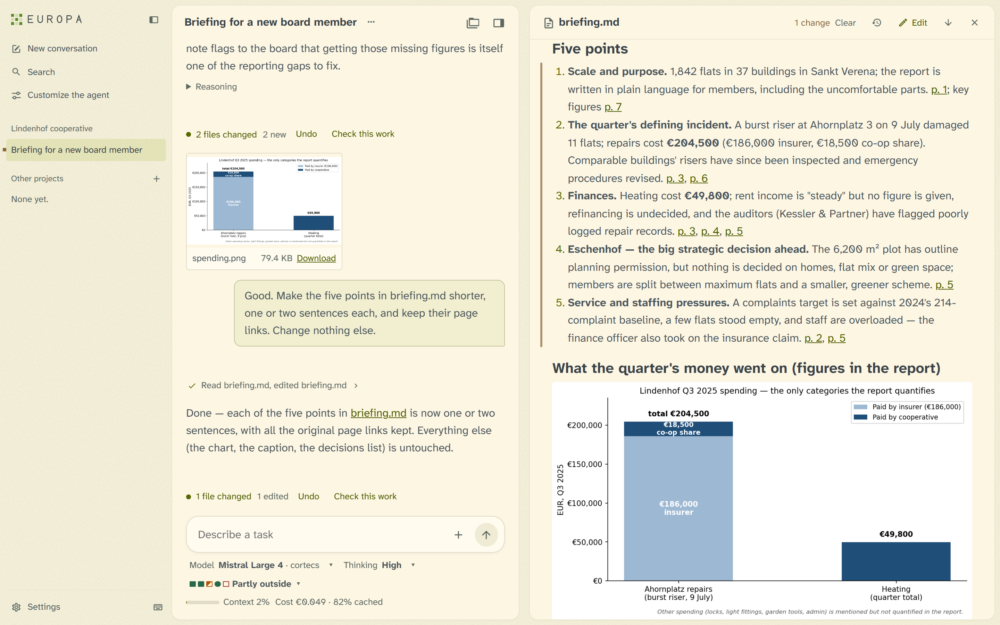

# Europa

Europa is an experimental AI agent made by Accelerate Europe (Vienna, Austria; https://accelerate-europe.org). It runs on your computer: each project gets its own virtual machine there, and the agent reaches a model only through Europa's gateway, which holds your key.

## What makes Europa different

### You see how European each part of your AI is, and how sure that is

Most AI tools leave you guessing where your work goes. Europa shows you. A task passes through five parts: Europa on your computer, the provider you have a contract with, the servers the model runs on, the model's maker, and web search. Each part gets two answers, which are never added up:

- **How European it is,** as a colour. Green means a European company handling your data in Europe. Orange means in Europe but under foreign reach, such as a US company's data centre in the EU. Red means outside Europe.
- **How sure that is,** as dots. These range from a company's own word, through its documents and independent audits, to a check anyone can run. Each mark links to its evidence.

So a well-audited US cloud shows orange with three dots, and a European start-up that only says so shows green with one. Both are true, and Europa shows both.

The marks follow **Stackmark**, an open method for how European, and how sure, each part of a digital stack is, with the evidence for every claim. Accelerate Europe is developing it alongside Europa, and will publish it on its own.

### European first, and pragmatic

- **Europe is the default.** Europa recommends a European provider and European models, and marks them green.
- **But you are not locked in.** When a task needs the strongest model, the leading US models are one click away. They are marked as what they are, so you choose knowingly.
- **You set how far your work may go.** There are three levels: European companies only; Europe, including US companies' data centres there; or anywhere. Europa holds every project's models and web search to your choice, for every agent.

### Safe by design

- **The agent has a computer of its own.** Each project runs in its own Linux virtual machine on your PC. There the agent can run code, install software and make documents. It sees only the project's files and the folders you add, and it never holds your API key.
- **Nothing leaves without Europa.** All of the agent's traffic passes through Europa. By default the agent may read public web pages, and it can send things only where you allow.
- **Nothing irreversible without you.** You can undo what a task changed. Europa asks before anything undo cannot reverse: rewriting a repository's history, deleting beyond undo's reach, or sending to a site set to ask.

### Built for real work

Europa reads PDFs and Office files and cites the pages it used. It makes charts and reports, and works with git and with Obsidian notes. When it changes your documents, it marks the changes.

> **Experimental, for trying out.** Europa 0.2.0 is the first version you can download, for Windows. Expect rough edges, and do not rely on it yet for real or sensitive work: the source code is not public yet, and everything may change.

## Download

**Windows 10 or 11, 64-bit:** open the [latest release](https://github.com/accelerate-europe/europa-releases/releases/latest) and download the file ending in `-setup.exe` (about 80 MB).

A version for Mac is in the works.

## A closer look

**Where your work goes.** The card above opens from the marks under the message box. In it, the model is European and its provider is a European company. The servers are in US companies' data centres in the EU, and web search goes to the United States.

**How far your work may go.** A choice in Settings that Europa enforces in every project: European companies only; Europe, including US companies' data centres there; or anywhere.

**The agent's changes, marked.** After the agent revised the note, the changed passage is marked. Under the answer are the files it changed, with Undo, and "Check this work", which hands the result to a fresh agent to check.

## Install and start

1. **Open the file you downloaded.** Europa installs for you alone and needs no administrator.
2. **If Windows says "Windows protected your PC",** choose "More info", then "Run anyway". Windows says this because the installer is not yet signed with a code-signing certificate.
3. **On its first start, Europa downloads its agent** (about 450 MB, once).
4. **Connect a model provider.** This is a service that runs the AI models; you pay it for what you use. Europa recommends a European one, and opens its page so you can get a key. Europa shows what each conversation costs.
5. **Try it with the sample report:** Europa adds a short made-up report and a task to start from. The screenshots above began that way. The three tasks cost five euro cents together.

If "Windows Hypervisor Platform" is off on your computer, Europa still starts, but runs the agent more slowly. It offers to turn the feature on, which takes an administrator's permission and a restart of Windows.

## Updates

Europa looks for a new version when it starts, and once a day. It fetches one small file from this repository, which tells nothing about you or your work. When there is a new version, Europa says so, and installs it only when you choose "Restart and update". It installs only versions that carry Europa's signature. You can turn the daily look off in Settings › About.

## What Europa reaches

Europa has no account of its own and sends no usage data. Apart from the model provider you choose and the services you add yourself (such as MCP servers or packages), it reaches:

- this repository on GitHub, for the agent and for updates;
- the European Central Bank, for the dollar's daily rate, so it can show costs in euros;
- the search service it shows you, when you let the agent search the web.

The agent itself reaches the web only as described above, through Europa. Europa is built on [Pi](https://github.com/earendil-works/pi) and [Gondolin](https://github.com/earendil-works/gondolin).

## Problems and questions

Please open an issue in [this repository's Issues](https://github.com/accelerate-europe/europa-releases/issues): what you did, what you expected, and what happened instead. Issues are public, so leave out anything private.

Europa writes what it does to `%LOCALAPPDATA%\Europa\logs\europa.log`, which helps when something goes wrong. Look through it before you share any of it.

## Disclaimer

Europa is provided "as is", without warranty of any kind, express or implied, and you use it at your own risk. AI agents make mistakes, so check its work and keep backups. To the fullest extent permitted by law, no one involved in making it is liable for any loss or damage arising from its use.

## Licence

Copyright © 2026 Matthias Samwald. The source code is planned for publication under the GNU Affero General Public License, version 3 only (AGPL-3.0-only).

The installer includes QEMU (GNU GPL 2.0) and Node.js (MIT). Where to find their source code is listed in `notices\README.txt` of the installed program.
